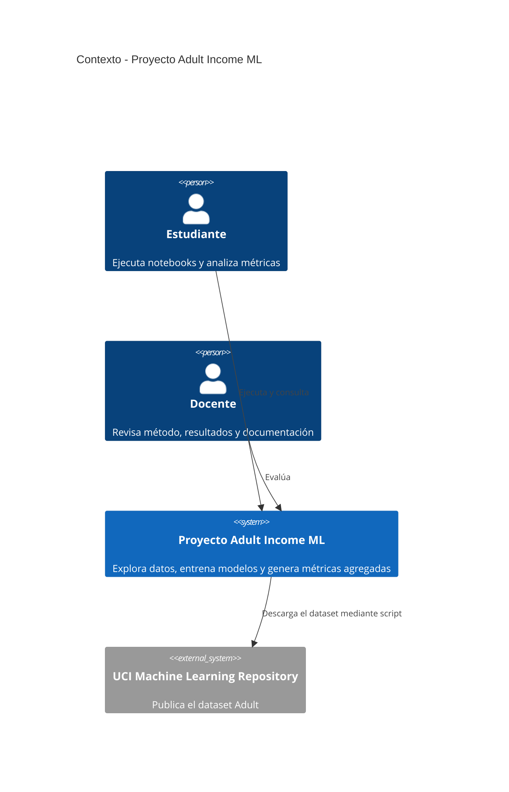

# Predicción académica de ingresos con Machine Learning

## 1. Problema, datos, solución y validez

El proyecto estudia una tarea de clasificación binaria: estimar si un registro del dataset **Adult** corresponde a ingresos anuales superiores a 50.000 USD (`>50K`). La fuente es el UCI Machine Learning Repository, conjunto [Adult (ID 2)](https://archive.ics.uci.edu/dataset/2/adult). Contiene 48.842 filas del censo de Estados Unidos de 1994.

El flujo carga y explora los datos, separa predictores de la etiqueta, divide train/test de forma estratificada (80/20, semilla 42), imputa faltantes, escala variables numéricas y codifica categorías dentro de un `Pipeline` de scikit-learn. Compara Regresión Logística con un `DummyClassifier` y un Árbol de Decisión, mide desempeño en test y desagrega métricas por sexo, raza y edad.

La validez se demuestra con una partición reservada, métricas calculadas sobre test, comparación con el baseline y criterios cuantitativos predefinidos. Los resultados reproducidos están en [`docs/informe_final.md`](docs/informe_final.md) y en los outputs de los notebooks. Un resultado satisfactorio no demuestra que el modelo sea justo ni adecuado para decisiones individuales.

## 2. Alcance del sistema

**El sistema hará:** cargar el dataset Adult, entrenar clasificadores básicos, comparar métricas y mostrar diferencias agregadas de desempeño entre grupos demográficos con fines educativos.

**El sistema no hará:** inferir ingresos actuales, explicar causalidad, identificar personas ni recomendar o automatizar decisiones de contratación, crédito, seguros, salarios u otros servicios. No constituye una evaluación individual válida ni un producto desplegable.

## 3. Diagrama C4 de contexto



La descripción independiente está en [`docs/c4_contexto.md`](docs/c4_contexto.md).

## 4. Decisiones de arquitectura (ADR)

- [ADR-001: selección del modelo](docs/adr/ADR-001-seleccion-modelo.md) - Regresión Logística como modelo principal, con Dummy y Árbol como comparaciones.
- [ADR-002: implementación y preprocesamiento](docs/adr/ADR-002-implementacion.md) - Python, notebooks y pipeline de transformación ajustado solo con train.
- [ADR-003: almacenamiento y despliegue](docs/adr/ADR-003-almacenamiento-despliegue.md) - ejecución académica local, datos regenerables y sin servicio de inferencia.

## 5. Calidad y evaluación

La clase positiva es `>50K`. Se reportan **accuracy**, **precision**, **recall** y **F1-score** en un conjunto de prueba estratificado del 20% (`random_state=42`). `DummyClassifier(strategy="most_frequent")` sirve como referencia mínima; se incluye Árbol de Decisión como alternativa interpretable.

| Modelo | Accuracy | Precision | Recall | F1-score |
|---|---:|---:|---:|---:|
| Regresión Logística | 0.8056 | 0.5632 | 0.8370 | 0.6733 |
| Árbol de Decisión | 0.7806 | 0.5248 | 0.8824 | 0.6582 |
| Dummy (most_frequent) | 0.7607 | 0.0000 | 0.0000 | 0.0000 |

Criterios académicos de aceptación, definidos para el test: accuracy > 0.75, F1 > 0.60, recall de `>50K` > 0.55 y superar al baseline en las cuatro métricas. La regresión logística cumple los cuatro criterios. Estos umbrales evalúan el ejercicio, no autorizan el uso real del modelo.

**Criterios de aceptación del software:** los tres notebooks deben ejecutar de principio a fin sin excepciones; la carga debe producir 48.842 filas y el split debe contener 39.073 filas de train y 9.769 de test; Notebook 02 debe guardar la tabla de tres modelos y las matrices de confusión; Notebook 03 debe guardar métricas para sexo, raza y edad; el informe PDF debe generarse desde Markdown. Los notebooks guardados en este repositorio satisfacen esos criterios en el entorno documentado.

## 6. Riesgos técnicos

| Riesgo | Impacto | Mitigación |
|---|---|---|
| Datos históricos y faltantes | Resultados poco aplicables a población o época actual; algunas categorías tienen ausentes. | Documentar la fecha y fuente; imputar dentro del pipeline; no extrapolar fuera del ejercicio. |
| Fuga de información | Métricas artificialmente optimistas si se ajusta el preprocesamiento con test. | Ajustar todo el pipeline solo con train y reservar test para la evaluación final. |
| Sobreajuste o sensibilidad al split | El resultado puede depender de la muestra y de la configuración elegida. | Mantener semilla fija, comparar contra baseline y describir que no se hizo validación externa. |
| Sesgo y desigualdad de representación | El desempeño difiere entre grupos y los grupos pequeños producen estimaciones inestables. | Publicar métricas desagregadas y tamaños, revisar impactos y restringir el uso a docencia. |
| Dependencia de herramientas y fuente externa | Cambios de paquetes o falta de conexión pueden impedir descargar o ejecutar. | Declarar dependencias, conservar el script de descarga y usar CSV local una vez obtenido. |

## 7. Glosario y referencias

- **Baseline:** clasificador de referencia que predice siempre la clase más frecuente.
- **Precision:** proporción de predicciones positivas que son positivas reales.
- **Recall:** proporción de positivos reales que el modelo detecta.
- **F1-score:** media armónica de precision y recall.
- **Fuga de información:** uso accidental de datos de test para ajustar transformaciones o modelos.
- **Tasa positiva predicha:** proporción de predicciones `>50K` en un grupo.
- **Pipeline:** composición de transformaciones y estimador que se ajusta como una sola unidad.

Referencias principales: [Adult Dataset, UCI](https://archive.ics.uci.edu/dataset/2/adult); [scikit-learn: Pipeline](https://scikit-learn.org/stable/modules/compose.html#pipeline); [scikit-learn: evaluación de clasificación](https://scikit-learn.org/stable/modules/model_evaluation.html#classification-metrics).

## 8. Reproducir el proyecto

Requiere Python 3.10 o posterior y conexión a Internet solo para descargar el dataset la primera vez.

```powershell
git clone https://github.com/Villaa03/proyectoFinal_andresFelipe.git
cd proyectoFinal_andresFelipe
git checkout dev_anvillanueva43
python -m venv .venv
.\.venv\Scripts\Activate.ps1
python -m pip install -r requirements.txt
python data/descargar_datos.py
```

Abre Jupyter y ejecuta los notebooks en orden:

```powershell
jupyter notebook
```

1. `notebooks/01_exploracion.ipynb`
2. `notebooks/02_modelo_y_metricas.ipynb`
3. `notebooks/03_analisis_etico.ipynb`

Genera o actualiza el PDF del informe desde su fuente Markdown:

```powershell
python scripts/generar_informe_pdf.py
```

Para volver a ejecutar y guardar los tres notebooks desde la terminal:

```powershell
jupyter nbconvert --to notebook --execute --inplace --ExecutePreprocessor.timeout=600 notebooks/01_exploracion.ipynb
jupyter nbconvert --to notebook --execute --inplace --ExecutePreprocessor.timeout=600 notebooks/02_modelo_y_metricas.ipynb
jupyter nbconvert --to notebook --execute --inplace --ExecutePreprocessor.timeout=600 notebooks/03_analisis_etico.ipynb
```

El entrenamiento y las métricas usan el CSV local; `python data/descargar_datos.py` regenera la copia desde UCI. Las tablas y gráficas generadas se guardan en `data/`; el CSV fuente se excluye de Git por tamaño y se obtiene con el script.
