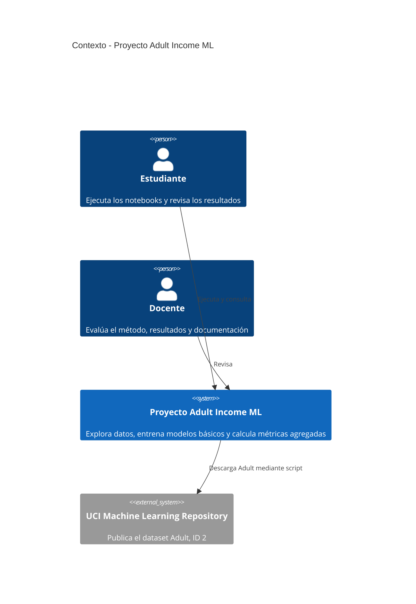

# C4 - Contexto del sistema

El diagrama identifica a quienes interactúan con el mini-proyecto, su límite y la fuente externa del dataset.

La solución se ejecuta localmente y no expone un servicio de predicción. La descarga desde UCI ocurre solo cuando se invoca el script correspondiente.
