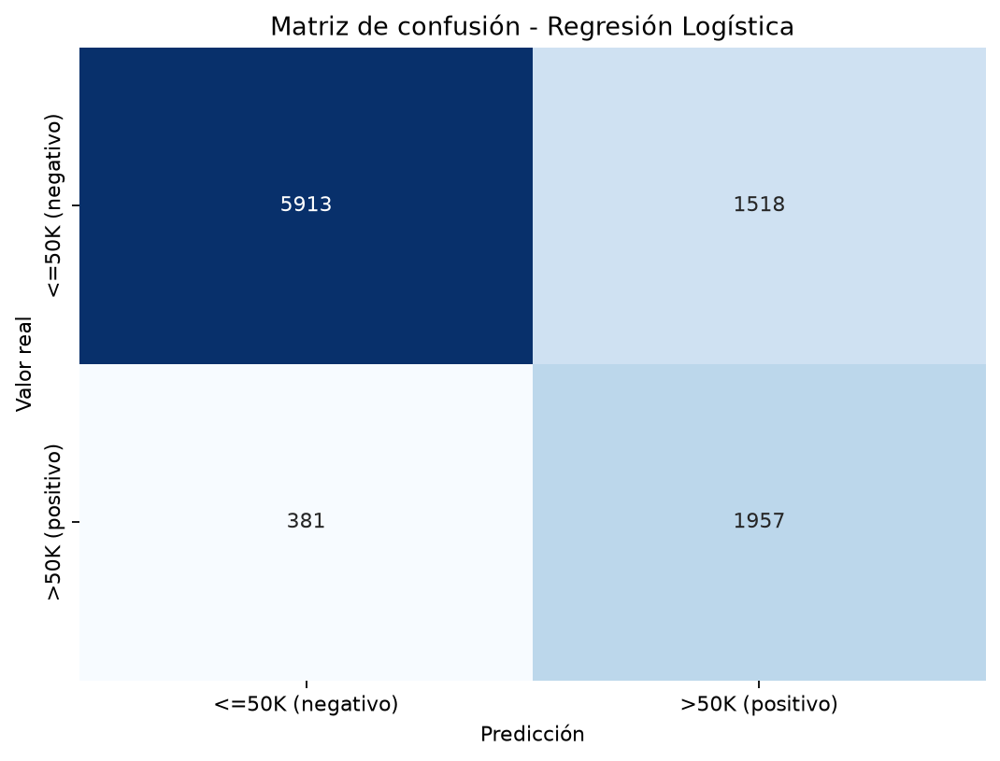

# Informe final - Proyecto Adult Income ML

**Autor:** Andrés Felipe Villanueva Parra  
**Rama de trabajo:** `dev_anvillanueva43`  
**Fecha:** 2026-11-03

## 1. Problema y datos

El objetivo académico es clasificar si una fila del dataset Adult corresponde a un ingreso anual superior a 50.000 USD (`>50K`). La fuente es el [UCI Machine Learning Repository, Adult (ID 2)](https://archive.ics.uci.edu/dataset/2/adult), basado en datos del Censo de Estados Unidos de 1994.

El dataset consolidado tiene **48.842 registros**. La clase positiva contiene 11.687 filas (23,9%) y la clase `<=50K` 37.155 (76,1%). Se excluye `fnlwgt` del modelo porque es un peso censal. Se usan 13 predictores: cinco numéricos (`age`, `education-num`, `capital-gain`, `capital-loss`, `hours-per-week`) y ocho categóricos (`workclass`, `education`, `marital-status`, `occupation`, `relationship`, `race`, `sex`, `native-country`).

## 2. Preparación y separación

El conjunto se divide en **39.073 filas de train** y **9.769 de test**, con estratificación por etiqueta y `random_state=42`. El conjunto de test se usa una vez al final de cada flujo de modelado.

| Tipo | Transformación | Faltantes y ajuste |
|---|---|---|
| Numérico | `SimpleImputer(strategy="median")` y `StandardScaler` | Medianas y escala se aprenden solo de train. |
| Categórico | `SimpleImputer(strategy="most_frequent")` y `OneHotEncoder(handle_unknown="ignore")` | Moda y categorías se aprenden solo de train; las categorías no vistas no fallan en test. |

La fuente presenta valores desconocidos en `workclass`, `occupation` y `native-country`, que el cargador normaliza como faltantes. El preprocesamiento está dentro de un `Pipeline` de scikit-learn para evitar fuga de información.

## 3. Modelos

- **Regresión Logística:** modelo principal, `class_weight="balanced"`, `max_iter=1000`, semilla 42.
- **DummyClassifier:** baseline `most_frequent`, predice la clase más frecuente.
- **Árbol de Decisión:** comparación con `max_depth=5` y `class_weight="balanced"`.

## 4. Resultados en el test

Los siguientes valores se generaron al ejecutar el Notebook 02 con Python 3.12.14, pandas 3.1.0 y scikit-learn 1.9.1. Las métricas están redondeadas a cuatro decimales.

| Modelo | Accuracy | Precision | Recall | F1-score |
|---|---:|---:|---:|---:|
| Regresión Logística | 0.8056 | 0.5632 | 0.8370 | 0.6733 |
| Árbol de Decisión | 0.7806 | 0.5248 | 0.8824 | 0.6582 |
| DummyClassifier | 0.7607 | 0.0000 | 0.0000 | 0.0000 |

La regresión logística mejora todas las métricas frente al Dummy. El Árbol obtiene mayor recall, pero menor accuracy, precision y F1 que la regresión logística. En este problema precision y recall describen compromisos distintos: el recall mide cuántos ingresos `>50K` se detectan; precision indica cuántas predicciones `>50K` son correctas.

### 4.1 Matriz de confusión de Regresión Logística

| Etiqueta real | Predicho <=50K | Predicho >50K |
|---|---:|---:|
| Real <=50K | 5.913 (VN) | 1.518 (FP) |
| Real >50K | 381 (FN) | 1.957 (VP) |

- **Verdaderos positivos (VP):** 1.957 filas con ingresos reales `>50K` clasificadas como positivas.
- **Verdaderos negativos (VN):** 5.913 filas `<=50K` clasificadas como negativas.
- **Falsos positivos (FP):** 1.518 filas `<=50K` clasificadas como `>50K`.
- **Falsos negativos (FN):** 381 filas `>50K` clasificadas como `<=50K`.

### 4.2 Criterios de aceptación académica

| Criterio | Umbral | Resultado | Estado |
|---|---:|---:|---|
| Accuracy | >0.75 | 0.8056 | Cumple |
| F1-score | >0.60 | 0.6733 | Cumple |
| Recall de `>50K` | >0.55 | 0.8370 | Cumple |
| Mejora sobre Dummy | Las cuatro métricas | Sí | Cumple |

Estos umbrales se definieron para verificar el ejercicio de curso; no son una norma de calidad para un modelo desplegado ni un aval para usarlo con personas.

## 5. Análisis ético por grupos

Se reentrena la regresión logística con la misma división para medir recall, precision, F1 y tasas de positivos reales y predichas por grupo. Los valores son descriptivos del conjunto test y dependen de la etiqueta histórica de la fuente.

### 5.1 Sexo

| Grupo | N | Tasa real >50K | Tasa predicha >50K | Recall | Precision | F1 |
|---|---:|---:|---:|---:|---:|---:|
| Female | 3.289 | 0.1116 | 0.1396 | 0.6839 | 0.5468 | 0.6077 |
| Male | 6.480 | 0.3042 | 0.4654 | 0.8656 | 0.5656 | 0.6842 |

Brecha max-min de recall: **0.1817**. Brecha max-min de tasa positiva predicha: **0.3258**.

### 5.2 Raza

| Grupo | N | Tasa real >50K | Tasa predicha >50K | Recall | Precision | F1 |
|---|---:|---:|---:|---:|---:|---:|
| Amer-Indian-Eskimo | 104 | 0.0865 | 0.2019 | 0.6667 | 0.2857 | 0.4000 |
| Asian-Pac-Islander | 304 | 0.2566 | 0.4046 | 0.8462 | 0.5366 | 0.6567 |
| Black | 944 | 0.1282 | 0.1515 | 0.6529 | 0.5524 | 0.5985 |
| Other | 69 | 0.1594 | 0.1884 | 0.6364 | 0.5385 | 0.5833 |
| White | 8.348 | 0.2538 | 0.3803 | 0.8490 | 0.5666 | 0.6796 |

Brecha max-min de recall: **0.2126**. Brecha max-min de tasa positiva predicha: **0.2531**. El grupo `Other` incluye 69 filas de test; las tasas de grupos pequeños son menos estables.

### 5.3 Rango de edad

| Rango | N | Tasa real >50K | Tasa predicha >50K | Recall | Precision | F1 |
|---|---:|---:|---:|---:|---:|---:|
| 18-29 | 2.945 | 0.0499 | 0.0954 | 0.7143 | 0.3737 | 0.4907 |
| 30-39 | 2.517 | 0.2706 | 0.3747 | 0.7959 | 0.5748 | 0.6675 |
| 40-49 | 2.124 | 0.3719 | 0.5061 | 0.8620 | 0.6335 | 0.7303 |
| 50-59 | 1.382 | 0.3734 | 0.5499 | 0.8527 | 0.5789 | 0.6897 |
| 60+ | 801 | 0.2547 | 0.5194 | 0.9265 | 0.4543 | 0.6097 |

Brecha max-min de recall: **0.2122**. Brecha max-min de tasa positiva predicha: **0.4545**.

Las brechas indican diferencias observadas en este test y bajo este umbral; no son por sí solas una prueba estadística de discriminación ni una definición completa de justicia. La tasa base real varía por grupo, y distintos criterios de equidad pueden entrar en tensión.

## 6. Sesgos, privacidad e impacto social

1. **Sesgo histórico y temporal:** las etiquetas reflejan condiciones económicas y sociales de Estados Unidos en 1994; no describen ingresos presentes ni otras poblaciones.
2. **Representación desigual:** los tamaños de grupo son diferentes; un valor agregado puede ocultar errores concentrados y los grupos pequeños presentan mayor incertidumbre.
3. **Variables proxy:** educación, ocupación, estado civil y otras variables pueden codificar desigualdades vinculadas a atributos sensibles.
4. **Equidad:** se observan diferencias en recall y tasas positivas predichas por sexo, raza y edad. Igualdad de oportunidad y paridad demográfica no se satisfacen simultáneamente en estas tablas.
5. **Privacidad:** el dataset es público y no contiene nombres en este análisis, pero combina atributos sensibles. Se conservan métricas agregadas, se excluyen perfiles individuales del repositorio y no se intenta reidentificar registros.
6. **Transparencia y justicia:** la predicción no explica causas ni sustituye una valoración individual. Una eventual aplicación necesitaría validación actual, análisis de impacto, revisión humana, explicación entendible y mecanismo de reclamación.

El impacto de automatizar decisiones laborales o económicas con este modelo podría amplificar desigualdades y restringir oportunidades. Por ello, el sistema se limita explícitamente a docencia y no debe usarse para contratación, crédito, seguros, salarios u otros contextos de alto impacto.

## 7. Conclusiones y recomendaciones

- La regresión logística supera al baseline con accuracy 0.8056 y F1 0.6733; detecta 83.70% de los positivos en el test.
- Los tres criterios de umbral y la comparación con baseline se cumplen en la partición definida.
- Hay diferencias descriptivas relevantes entre grupos; el resultado no permite inferir equidad o desempeño fuera de este dataset histórico.
- Para continuar el trabajo: validar con datos actuales y representativos, reportar incertidumbre por grupo, evaluar más de una partición, justificar las variables y realizar una revisión independiente de impacto y privacidad.
- Mantener el uso como ejercicio académico sin despliegue ni decisiones automatizadas sobre personas.

## 8. Archivos y reproducción

| Archivo | Propósito |
|---|---|
| `data/descargar_datos.py` | Descarga reproducible desde UCI. |
| `notebooks/01_exploracion.ipynb` | Exploración de datos y faltantes. |
| `notebooks/02_modelo_y_metricas.ipynb` | Entrenamiento, métricas y matrices de confusión. |
| `notebooks/03_analisis_etico.ipynb` | Métricas por sexo, raza y edad. |
| `data/tabla_metricas.csv` | Comparación de modelos reproducida. |
| `data/metricas_por_*.csv` | Tablas de evaluación por grupo. |
| `data/confusion_lr.png` | Matriz de confusión de Regresión Logística. |

Desde la raíz del repositorio, instala las dependencias con `python -m pip install -r requirements.txt`, descarga Adult con `python data/descargar_datos.py` y ejecuta los notebooks en el orden 01, 02, 03. Los comandos completos están en el README. La copia fuente `data/adult_income.csv` no se versiona.

## Referencias

- Dua, D. y Graff, C. *UCI Machine Learning Repository: Adult*. [https://archive.ics.uci.edu/dataset/2/adult](https://archive.ics.uci.edu/dataset/2/adult)
- Pedregosa, F. et al. *Scikit-learn: Machine Learning in Python*. [https://scikit-learn.org/](https://scikit-learn.org/)
- Proyecto implementado con Python, pandas, scikit-learn, matplotlib, seaborn y Jupyter; versiones instaladas durante esta ejecución declaradas en la salida del entorno local.
